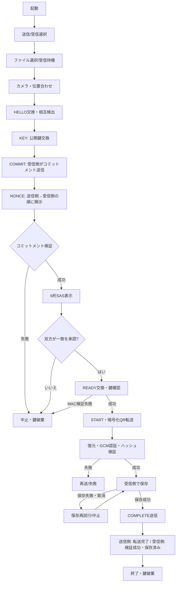

# qrbeam 仕様書 — PC専用オフラインQRファイル転送

- アプリ名: **qrbeam**
- 英語表記: **qrbeam — Secure Offline File Transfer via QR Codes**
- GitHubリポジトリ名: `qrbeam`
- 配布ファイル名: `qrbeam.html`
- 文書版: 1.1（レビュー反映版・初期実装仕様）
- 作成日: 2026-11-19（1.0）／改訂日: 2026-11-19（1.1）
- 対象: Windows / macOS / Linux のPC
- 目的: 同一室内の2台のPC間で、ネットワークおよび可搬記憶媒体を使わず、画面とカメラのみで機密ファイルを安全に受け渡す。
- 状態: 開発用ドラフト。実運用前に大学の情報セキュリティ担当者による審査・承認を要する。

### 改訂履歴

| 版 | 主な変更 |
|---|---|
| 1.0 | 名称確定版・初期実装仕様 |
| 1.1 | 鍵合意にコミットメントを追加（SAS総当たり対策）、SAS方式をBLE Secure Connections Numeric Comparisonの構造に準拠して確定、方向別MAC鍵の導入と鍵導出後の全フレームのMAC付与、COMPLETEを保存後送信に変更、S4のEnter誤承認対策、QRエンコードをテキスト方式に、選択的再送ACKとウィンドウ評価、監査ログの鍵付きダイジェスト化とパディング方針、配布物の署名・検証、軽微事項（非抽出鍵、HKDFパラメータ、公開鍵検証、CSP、ファイル名正規化、SAS連続不一致、自己反射、セッション有効期限、承認待ち上限） |

## 1. スコープと基本方針

### 1.1 対象

- 2台のPC間で1ファイルを転送する。
- ブラウザ上で動作する、事前配布済みの完全オフラインWebアプリとする。
- 通信経路は各PCのディスプレイとカメラだけとする。
- ファイルの内容は光学伝送前に暗号化する。
- 送信・受信を明示的に選び、認証コード照合と双方承認の後に転送する。

### 1.2 初期版の対象外

- スマートフォン、タブレット、3台以上の接続、複数ファイルの一括転送。
- WebRTC、Wi-Fi、Bluetooth、LAN、インターネット、クラウド、USBによる転送。
- 別室・遠隔地間の通信。
- 常時接続型チャット、バックグラウンド転送。

### 1.3 初期制約

| 項目 | 仕様 |
|---|---|
| 対応OS | Windows / macOS / Linux |
| 対応ブラウザ | Chrome / Edge を初期検証対象。Firefox / Safariは検証後に追加 |
| 通信相手 | 1台 |
| ファイル | 1回につき1ファイル |
| ファイル上限 | 1 MiB（1,048,576バイト） |
| ファイル名 | UTF-8、最大255バイト。受信時にNFC正規化と安全な名前への変換を行う（§9） |
| 通信 | 画面表示QRとカメラ読み取りのみ |
| 暗号 | 一時ECDH P-256、HKDF-SHA-256、AES-256-GCM、HMAC-SHA-256 |
| 認証 | コミットメント付き6桁SAS（Short Authentication String）の目視照合（§7.2） |
| 操作 | マウス操作またはEnterキー（S4ではEnter誤承認防止措置あり、§3.1） |
| 保存 | 受信PCに明示操作で保存。保存完了後に送信側へ完了を通知する。アプリは自動的に外部送信しない |

**注:** 1 MiBは初期版の上限であり、速度保証ではない。実測に基づき変更する（§12.2の見積もり参照）。

## 2. 利用条件と配置

- 2台のPCを同一室内に設置し、双方の画面を相手のカメラが撮影できるように向かい合わせる。
- 一般的なノートPCではディスプレイ上部の前面カメラを利用する。外付けWebカメラも許可する。
- 画面の明るさ、QRコードの表示サイズ・位置、端末間距離を調整できる。
- カメラが相手の画面を認識できない場合、ユーザーへ配置修正を案内する。
- 機密データを扱う際は、端末のネットワーク接続を運用上無効化し、周囲からの撮影・覗き見を防ぐ。
- 起動前に、配布物 `qrbeam.html` の署名とハッシュを検証する（§8.4）。

## 3. ユーザー操作フロー

1. 双方のPCで、署名検証済みの `qrbeam.html` を起動する。
2. PC Aで「送信」を選択し、送信するファイルを選ぶ。PC Bで「受信」を選択する。
3. アプリはカメラ許可を求め、両端末に位置合わせ用QR（HELLO）を表示する。
4. 両画面を向かい合わせる。双方が相手のHELLOを読み取り、HELLO_ACKで相互到達を確認する。自分自身のHELLO（反射等）は破棄する。
5. アプリが §7.1 の手順で鍵合意を行う（公開鍵交換 → 受信側のコミットメント → 送信側nonce開示 → 受信側nonce開示 → コミットメント検証）。
6. 双方の画面に同じ6桁認証コードを表示する。
7. ユーザーが双方のコードを目視で比較する。各端末で「コードが一致・開始」をクリックするか、フォーカスされた同ボタンでEnterを押す（Enterの受付条件は§3.1）。
8. 双方がMAC付きREADYを交換し、相手のREADYを検証する（鍵確認を兼ねる）。両方の承認が確認された後、送信側がSTARTを送り、暗号化したファイルをQRフレームとして送る。
9. 受信側がファイルを復元し、GCM認証とハッシュ照合を行う。
10. 受信側は保存操作を行う。保存が完了した後に、MAC付きCOMPLETEをQRで返す。
11. 送信側はCOMPLETEを検証して初めて「転送完了」と表示する。受信側は「検証成功・保存済み」と表示する。
12. 双方はセッションを終了し、一時鍵を破棄する。

### 3.1 重要なUI上の条件

- 「鍵交換完了」は「相手認証完了」ではない。SAS一致を双方が承認するまで機密データを送信しない。
- Enterキーは画面上の明示的な承認ボタンに対応させる。自動承認・タイムアウト承認は禁止する。
- **S4でのEnter誤承認防止:** S4表示後、次の条件をすべて満たすまでEnterによる承認を無効にする。
  - S4表示から一定時間（`sas_enter_guard_ms`、初期値1500ミリ秒）が経過している。
  - S4表示時点でEnterが押下中だった場合（アプリ全体でkeydown/keyupを追跡して判定）、そのEnterのkeyupを確認している。ウィンドウがフォーカスを失った場合は押下中として扱い、keyupの確認を要する。
  - 受け付けるkeydownは `event.repeat === false` のものに限る。
- 承認後、双方の承認メッセージ（READY）を交換する。片方の承認だけでは開始しない。
- 転送中断・失敗・認証不一致・保存未完了の場合、ファイルを完成扱いにしない。

## 4. 画面仕様

| ID | 画面 | 表示・操作 |
|---|---|---|
| S0 | モード選択 | 「送信」「受信」、カメラ・オフライン状態 |
| S1-S | ファイル選択 | ファイル名、サイズ、上限検証、「次へ」 |
| S1-R | 受信待機 | 保存先に関する案内、「次へ」 |
| S2 | 位置合わせ | カメラプレビュー、QR、検出状態、表示位置・サイズ調整、カメラ選択 |
| S3 | 鍵交換 | 公開鍵・コミットメント・nonce交換の進捗、通信失敗時の再表示状況 |
| S4 | 認証確認 | 大きな6桁コード、「コードが一致・開始」「中止」。Enter受付条件は§3.1 |
| S5 | 相互承認待ち | 自分と相手の承認状態、接続状態、承認待ち残り時間 |
| S6 | 転送中 | 進捗、転送済みバイト数、経過時間、再送状況、「中止」 |
| S6-S2 | 受信側保存待ち（送信側） | 「受信側で保存操作中」、待機残り時間、「中止」 |
| S7 | 検証・保存（受信側） | 検証結果、ファイル名、サイズ、「保存」。保存失敗・取消時は再試行/中止 |
| S8-S | 完了（送信側） | 「転送完了」（検証済みCOMPLETE受信）、ファイルダイジェスト、ログ識別子、「終了」 |
| S8-R | 完了（受信側） | 「検証成功・保存済み」、ファイルダイジェスト、ログ識別子、送信側の「転送完了」表示を確認するよう案内、「終了」 |
| E | エラー | 原因、再試行/最初から/中止 |

**UI注記:** S2〜S8ではカメラとQR表示が同時に必要（S8-RはCOMPLETEを表示し続ける）。カメラプレビューを小さく表示し、QR表示領域を確保する。機密ファイルの内容はプレビューしない。

## 5. 状態遷移



いずれの状態からも、CANCEL受信・タイムアウト上限超過・セッション有効期限切れで「中止・鍵破棄」へ遷移する。

## 6. 光学通信プロトコル

### 6.1 役割

- `sender`：ファイル送信端末。主にデータQRを表示する。鍵合意では「開始側」となる。
- `receiver`：受信端末。主にACK/再送要求QRを表示する。鍵合意では「応答側」となり、コミットメントを送る。
- 両端末はカメラで相手のQRを継続監視する。

### 6.2 メッセージ種別

| 種別 | 方向 | 内容 | MAC |
|---|---|---|---|
| HELLO | 双方 | プロトコル版、ロール、ランダム端末nonce（`n_dev`、128ビット）、機能情報 | なし |
| HELLO_ACK | 双方 | 相手HELLOの受信証明、相互検出確認 | なし |
| KEY | 双方 | 一時ECDH公開鍵（非圧縮形式） | なし |
| KEY_ACK | 双方 | 相手の公開鍵の受信確認 | なし |
| COMMIT | receiver→sender | コミットメント `C_R`（§7.1） | なし |
| NONCE | 双方（sender→receiverの順） | SAS用nonce（`N_S` または `N_R`、128ビット） | なし |
| READY | 双方 | SAS照合後のローカル承認。トランスクリプトハッシュを含む。鍵確認を兼ねる | あり |
| START | sender→receiver | 双方承認を確認した転送開始通知 | あり |
| DATA | sender→receiver | 暗号文の分割データ | あり |
| ACK | receiver→sender | 受信済み範囲（ビットマップ）、次の要求 | あり |
| NACK | receiver→sender | 欠落・不正フレームの再送要求 | あり |
| FIN | sender→receiver | データ送信終了 | あり |
| COMPLETE | receiver→sender | 全体検証成功かつ保存完了の確認。ファイルダイジェスト（§7.4）を含む | あり |
| CANCEL / ERROR | 双方 | 中止、エラー理由コード（機密情報を含めない） | 鍵導出後はあり |

- 送信側のMETA（暗号化されたファイル名・サイズ・ファイルハッシュ等）は独立メッセージとせず、§7.4の単一暗号文に含めてDATAで送る。
- 鍵導出前のメッセージ（HELLO〜NONCE）はMACを持たない。改ざんはSAS照合とコミットメント検証で検出する。

### 6.3 フレーム構造

各QRには、少なくとも以下を含むバイナリフレームをエンコードする。

```text
magic | protocol_version | message_type | session_id |
sequence_number | payload_length | payload | mac | frame_checksum
```

- `session_id`は今回のセッションに固有の128ビット値。HELLO段階では未確立値（全ゼロ）とし、HELLO_ACK後に `session_id = SHA-256("qrbeam-v1 sid" || n_dev_S || n_dev_R)` の先頭128ビットとする。別セッションのQRを誤認しない。
- `sequence_number`は送信方向ごとに独立に採番し、重複・欠落・順序逆転を検出する。
- `mac`は鍵導出後のフレームにのみ付与する。方向別MAC鍵（§7.1）によるHMAC-SHA-256を128ビットに切り詰めたもので、`magic`から`payload`までの全フィールドを対象とする。MAC検証に失敗したフレームは破棄し、状態を変えない。
- `frame_checksum`（CRC-32）は光学読み取りエラーや表示切替中の撮影による誤読の早期検出用であり、暗号学的認証の代わりにはしない。
- 自分が送信したHELLO（自分の`n_dev`を含むもの）を読み取った場合は破棄する。
- **QRへの格納方式:** `BarcodeDetector` は読み取り結果を文字列（`rawValue`）で返し、QRバイトモードのバイナリは環境によって文字コード変換で壊れうる。このため、フレームはテキストエンコード（Base45をQR英数字モードで格納することを第一候補とする）でQRに格納し、同梱デコーダと `BarcodeDetector` のどちらでも同じ結果を得られるようにする。最終的な方式は実装前のベンチマークで確定する。
- 同一フレームを複数回読んでも副作用が発生しないよう、状態遷移を冪等にする。

### 6.4 送信制御

- **選択的再送ACK方式**を採用する。受信側はACKで受信済みフレームをビットマップで返し、送信側は未受信フレームのみを再表示する。
- 送信側は、ウィンドウサイズ `window_size` 枚のDATAフレームを巡回表示する。ストップ・アンド・ウェイト（`window_size = 1`）と小さなスライディングウィンドウ（候補2/4/8）をM2で比較し、初期値を実測で決める。
- QR表示は受信側ACKと連動し、フレーム切替がカメラの読み取りを追い越さないようにする。フレーム表示の最小間隔 `min_frame_interval_ms` を設定値とする（ローリングシャッターで表示切替中を撮影する誤読への対策）。
- タイムアウト時は同一フレームを再表示する。無限再送を避け、再試行回数と時間に上限を設ける。
- 受信側はACKを相手が認識するまで表示し続ける。ACK消失に備え、重複DATAにも同じACKを返す。
- 鍵合意中の再送（KEY・COMMIT・NONCE）は、必ず同じ値を再表示する。同一セッション内で鍵ペアやnonceを再生成してはならない。再生成が必要な状況では、セッションを破棄して新規セッションでやり直す。
- QR誤り訂正レベル、ペイロード長、表示時間、フレームレート、ウィンドウサイズは環境依存の設定値とする。
- Fountain codeは将来の高速化候補。初期版では必須とせず、確実なACK/再送方式を優先する。

## 7. 暗号・認証仕様

### 7.1 一時鍵合意

本節の構造は、Bluetooth Core Specification の LE Secure Connections における Numeric Comparison 方式（認証ステージ1：応答側によるnonceコミットメント）に準拠する。暗号関数は AES-CMAC ではなく HMAC-SHA-256 / SHA-256 に置き換える。

以下、`||` は長さ前置き付きの連結（各要素の前に32ビットの長さを置く）、`PK_S` / `PK_R` は非圧縮形式の公開鍵、ラベルはASCII文字列とする。

1. 両端末が Web Crypto API で一時ECDH P-256鍵ペアを生成する。秘密鍵は `extractable: false` とし、端末外へ出さない。
2. KEYで公開鍵を交換する。受信した公開鍵は importKey で検証し、曲線上にない点・無限遠点・不正な形式を拒否してセッションを中止する。
3. receiverは128ビットの乱数 `N_R` を生成し、コミットメントを計算してCOMMITで送る。
   `C_R = HMAC-SHA-256(key = N_R, msg = "qrbeam-v1 commit" || PK_R || PK_S || session_id)`
   receiverは`PK_S`を受信するまでCOMMITを送ってはならない。
4. senderは `C_R` を受信した後にのみ、128ビットの乱数 `N_S` をNONCEで送る。
5. receiverは `N_S` を受信した後にのみ、`N_R` をNONCEで送る。
6. senderは `C_R` を再計算して照合する。不一致の場合はSASを表示せず、即時中止・鍵破棄とする。
7. 双方がECDH共有秘密 `Z` を得る。
8. トランスクリプトハッシュを計算する。
   `TH = SHA-256("qrbeam-v1 transcript" || protocol_version || "sender" || "receiver" || n_dev_S || n_dev_R || session_id || PK_S || PK_R || C_R || N_S || N_R)`
9. HKDF-SHA-256で用途別鍵を導出する。
   - IKM: `Z`
   - salt: `N_S || N_R`（固定長256ビット）
   - info: `"qrbeam-v1 " + 用途ラベル || TH`
   - 用途ラベルと出力:
     - `"enc"` → `k_enc`（AES-256-GCM、sender→receiverのファイル暗号化専用）
     - `"mac s2r"` → `k_mac_s2r`（HMAC-SHA-256、sender発のフレーム用）
     - `"mac r2s"` → `k_mac_r2s`（HMAC-SHA-256、receiver発のフレーム用）
     - `"audit"` → `k_audit`（HMAC-SHA-256、ファイルダイジェスト用）
10. 導出鍵はすべて `extractable: false` で生成する。ECDHの共有秘密をビット列として一時的に扱う必要がある場合は、HKDF鍵としてimportした直後に参照を破棄する。

**方向の分離:** 各フレームのMACには送信元ロールに対応する鍵だけを使う。受信側は相手ロールの鍵で検証する。これにより、自分が送ったREADY等を撮影されて送り返される攻撃（リフレクション）を防ぐ。

### 7.2 6桁SAS

- SASは次の式で計算する（BLE SCの数値比較値の構造に準拠）。
  `SAS = uint64_be(SHA-256("qrbeam-v1 sas" || PK_S || PK_R || N_S || N_R || session_id)[0..8]) mod 1,000,000`
- 表示形式は `123 456` とする（6桁ゼロ埋め）。
- コミットメントにより、攻撃者は相手のnonceを知る前に自分の値を固定しなければならない。このため、1回のセッションで攻撃者がSASを一致させられる確率は約10⁻⁶に限られる。
- 6桁は約20ビットの比較強度である。認証不一致後の継続・自動再試行を禁止し、新規セッションでやり直す。
- 同一端末でSAS不一致（ユーザーによる「中止」）またはコミットメント検証失敗が連続 `sas_fail_warn_count`（初期値2）回に達した場合、攻撃の可能性を示す警告を表示し、監査ログに記録する。運用上の報告対象とする。
- コード一致の目視確認を双方に要求する。相手のコードを通信で自己申告させるだけの認証は認めない。
- 本方式は、実装後の第三者暗号レビューを必須とする。

### 7.3 双方の承認と鍵確認

- ユーザー操作により各端末でREADYを生成する。READYのペイロードは送信元ロールと `TH` を含み、送信元ロールのMAC鍵で認証する。
- 相手のREADYのMAC検証成功と `TH` の一致をもって、相手が同じ鍵を導出したこと（鍵確認）とみなす。検証失敗時は即時中止・鍵破棄とする。
- READYとSTARTを含め、鍵導出後のすべてのフレームのMACを検証する。
- 自分の承認と相手の検証済み承認が揃うまでファイルデータを送信しない。
- 片方だけが承認した状態の待機には上限（`approval_wait_timeout`）を設ける。超過した場合はセッションを中止する。
- 一方の中止でセッションを無効化する。

### 7.4 ファイル暗号化

- AES-256-GCMを利用する。
- 1 MiB上限の初期版では、ファイル本体とメタデータ（ファイル名、サイズ、SHA-256）を1つの認証付き暗号文にまとめ、暗号文をQRフレームに分割する方式を基本とする。
- **パディング:** ファイルサイズとフレーム数から外部にサイズが漏れることへの対策として、暗号化前の平文を `padding_block` の倍数に切り上げてパディングできるようにする。採否と単位は§15で確定する（候補の初期値は4 KiB）。
- 1回の暗号化ごとに一意な96ビットnonceを生成する。鍵・nonceの再利用を禁止する。`k_enc` はセッションごとに一意であり、初期版では1セッションにつき1回だけ暗号化する。
- AADにプロトコル版、セッションID、転送ID等を含める。
- 復号・GCM認証成功前に受信ファイルをユーザーへ完成品として提供しない。
- 復号後、送信側が認証付きメタデータに格納したSHA-256と再計算値を照合する。
- ファイル名は暗号化対象に含める。QRフレームの平文ヘッダーに機密メタデータを載せない。
- **ファイルダイジェスト:** COMPLETE・画面表示・監査ログには平文のSHA-256を出さず、`file_digest = HMAC-SHA-256(k_audit, ファイル本体)` を用いる。senderは受信したCOMPLETEの `file_digest` を自分の計算値と照合し、一致した場合にのみ「転送完了」と表示する。`k_audit` はセッション終了時に破棄されるため、このダイジェストは「同一セッションの送受信ログ同士の照合」にのみ使える。後日ファイル本体と照合する必要がある場合は、組織管理の鍵を別途用いる（§15）。
- セッション終了時に秘密鍵・導出鍵の参照を破棄する。ただしブラウザのメモリ消去を完全保証できるとは主張しない。
- セッション全体の有効期限 `session_max_lifetime` を設ける。超過した場合は、未完了でも鍵を破棄してセッションを終了する。

## 8. オフラインWebアプリの実装

### 8.1 推奨構成

```text
src/
  app/             # UI、画面遷移、状態管理
  camera/          # getUserMedia、QR検出
  qr/              # QR生成、エンコード、デコード
  protocol/        # メッセージ、状態機械、ACK/再送
  crypto/          # ECDH、HKDF、AES-GCM、HMAC、SAS、コミットメント
  transfer/        # ファイル分割、復元、検証、保存
  audit/           # ローカル監査イベント
  security/        # 入力検証、制限、例外処理
  tests/           # 単体・結合・E2Eテスト
```

- 言語: TypeScript。
- UI: 軽量なフロントエンド。外部CDN、リモートフォント、解析タグは禁止。
- 暗号: Web Crypto API。
- カメラ: `navigator.mediaDevices.getUserMedia()`。
- QR検出: 生バイトを返す同梱のローカル実装を基本とする。`BarcodeDetector` は対応環境（デスクトップ版ChromeではmacOS等に限られ、Windows/Linuxでは利用できない環境が多い）での高速化候補とし、OSによる差を前提に評価する。
- QR生成: ローカルに同梱したライブラリ。
- 保存: File System Access API（`showSaveFilePicker` → `createWritable` → `close`）を用い、`close()` の完了をもって「保存完了」とする。`<a download>` 方式では保存完了を確認できないため、初期版では使わない。同APIが使えないブラウザは非対応とする。
- 正式な配布成果物は、JavaScript・CSS・QR処理ライブラリをすべて埋め込んだ単一HTMLファイル `qrbeam.html` とする。外部CDNや追加ファイルへの依存は禁止する。

### 8.2 ローカル実行の注意

`file://`で開くWebアプリは、ブラウザやAPIによってカメラ利用・モジュール読み込み・ファイル保存の挙動が異なる。**ローカルHTMLをダブルクリックするだけで全ブラウザで動くとは保証しない。**

正式配布方式は `qrbeam.html` を `file://` で直接開く単一HTML方式とする。Windows/macOS/Linuxの対応ブラウザで、カメラ・Web Crypto・File System Access APIによる保存を実機検証する。評価手順は次のとおり。

1. `file://`で必要APIがすべて動く単一HTMLビルド（対応ブラウザを明示）。
2. 動作しない環境では非対応と明示し、原因を調査する。`127.0.0.1`に限定したローカルHTTPサーバーは開発・診断用の代替手段としてのみ評価し、正式配布には含めない。

ローカルHTTPは**PC内部のループバック通信**であり、端末間のネットワーク転送ではない。ただし「ネットワーク通信一切禁止」の運用規程がループバックまで含む場合は、この方式も事前承認を要する。

### 8.3 ネットワーク非使用の保証

- アプリコードに外部向け `fetch`、WebSocket、WebRTC、XHR、Beacon等の通信経路を設けない。
- `<meta http-equiv="Content-Security-Policy">` で外部リソースの取得を制限する。単一HTMLのインラインスクリプト・スタイルは `'unsafe-inline'` を使わず、ビルド時に計算したハッシュで許可する。方針の例：
  `default-src 'none'; script-src 'sha256-…'; style-src 'sha256-…'; img-src data: blob:; connect-src 'none'; form-action 'none'; base-uri 'none'`
  最終的なディレクティブは、カメラ映像表示・QR描画・保存が動作することを実機で確認して確定する。
- ビルド成果物の依存関係と外部URLを検査する。
- OSレベルでネットワークアダプタを無効化した状態で全機能を試験する。
- Webアプリ単体ではOSやブラウザ全体の通信を完全に遮断できない。端末管理は別途必要。

### 8.4 配布物の完全性

- リリースごとに `qrbeam.html` のSHA-256を公開し、開発責任者の鍵で署名する（minisign または OpenPGP）。署名公開鍵は、配布物とは別の経路で利用者に配布する。
- 可能な限り再現可能ビルドとし、第三者が同一ソースから同一ハッシュの成果物を再生成できるようにする。
- 運用手順として、各PCで起動前に署名とハッシュを検証する。検証に失敗した場合は使用しない。
- アプリ画面（S0）にビルド識別子を表示し、手順書の値と照合できるようにする。

## 9. ファイル処理・安全性

- ファイルは送信側でメモリに読み込み、サイズ上限を検証する。
- 受信側では復号・検証成功後にのみ保存を許可する。
- 受信ファイル名は次の順に正規化する。
  1. Unicode NFCに正規化する（macOSのNFD表記との差異を解消する）。
  2. パス区切り（`/`、`\`）、制御文字、`..` 等の危険な相対パス表現、Windowsで使えない文字（`<>:"|?*`）を除去または置換する。
  3. 末尾のドットと空白を除去する。
  4. Windows予約名（`CON`、`PRN`、`AUX`、`NUL`、`COM1`〜`COM9`、`LPT1`〜`LPT9`。拡張子付きを含み、大文字小文字を区別しない）に該当する場合は、接頭辞を付けて回避する。
  5. 空になった場合は既定名を用いる。UTF-8で255バイト以内に切り詰める（文字境界を壊さない）。
- 正規化後の名前は保存ダイアログの初期値として提示するだけとし、最終的な保存先と名前はユーザーが決める。
- 受信ファイルを自動実行・自動オープンしない。
- ファイル名、本文、QRデータをログやエラー画面に出力しない。
- データの途中復元や一時データを永続保存しないことを基本とする。保存完了後、受信側は平文バッファの参照を破棄する。
- ページリロード、カメラ停止、電源断、タイムアウト時は安全に中断する。

## 10. 監査ログ

機密情報を含まない最小限の監査イベントをローカルに記録する。

| 項目 | 例 |
|---|---|
| セッションID | ランダム識別子 |
| ビルド識別子 | 使用した `qrbeam.html` の識別子 |
| 開始・終了時刻 | ローカル時刻（時刻精度は端末設定に依存） |
| ロール | sender / receiver |
| ファイルサイズ | バイト数（パディング採用時は、実サイズを記録するかどうかを§15で決める） |
| ファイルダイジェスト | `HMAC-SHA-256(k_audit, ファイル本体)`。同一セッションの送受信ログ照合用（§7.4） |
| イベント | 鍵合意完了、コミットメント検証失敗、SAS承認、SAS不一致、開始、保存完了、完了、中止 |
| 結果 | 成功 / 失敗 / 中止 / 完了未確認 |

- 平文ファイルのSHA-256はログに記録しない。内容の候補が限られるファイルでは、平文ハッシュから内容を確認できてしまうためである。
- ログの保存・書き出しは組織の監査規程に従う。初期版はユーザーが明示的にローカル保存する方式を想定。
- ログの改ざん防止や第三者証明が必要な場合は、別途署名・運用手順が必要。単なるローカルファイルは耐改ざんログではない。
- ダイジェストやファイルサイズ自体も情報を推測させる場合があるため、監査ログを機密扱いする。

## 11. エラー処理

| 状況 | 挙動 |
|---|---|
| カメラ利用拒否 | 理由と権限設定の案内。転送は開始しない |
| 相手QRを検出できない | 配置、距離、明るさ、カメラ選択を案内 |
| 自分のHELLOを読み取った | 破棄して相手QRの検出を続ける |
| 両端末が同じロール | 役割不一致を通知し、モード選択に戻す |
| 公開鍵が不正 | 即時中止・鍵破棄 |
| 鍵合意タイムアウト | 安全に破棄し、新規セッションでの再試行を案内 |
| コミットメント検証失敗 | SASを表示せず即時中止・鍵破棄。攻撃の可能性として監査ログに記録 |
| SAS不一致 | 即時中止・鍵破棄・新規セッションからやり直し |
| SAS不一致・コミットメント失敗の連続 | `sas_fail_warn_count` 回で警告を表示し、運用上の報告を案内 |
| READYのMAC検証失敗 | 即時中止・鍵破棄 |
| 片方だけ承認 | `approval_wait_timeout` まで承認待ちを継続。ファイルデータは送らない。超過したら中止 |
| MAC検証失敗フレーム | 破棄して状態を変えない。継続する場合は読取不能と同様に扱う |
| フレーム欠落 | 選択的再送ACK/NACKで再送 |
| 読取不能が継続 | 一時停止・位置調整・再試行 |
| 復号/GCM認証失敗 | 完了扱いにせず、失敗を表示 |
| ハッシュ不一致 | 保存を禁止し、失敗を表示 |
| 保存取消・保存失敗 | COMPLETEを送らない。受信側は保存を再試行できる。中止した場合はMAC付きCANCEL（理由: 保存未完了）を送り、送信側は「受信側で未保存」と表示する |
| 受信側の保存待ちが長い | 送信側はS6-S2で `save_wait_timeout` まで待機する。超過した場合は「完了未確認」とする |
| 完了ACK消失 | 受信側は「終了」操作までCOMPLETEを表示し続ける。送信側はCOMPLETEを検証できるまで完了未確認とする |
| COMPLETEのダイジェスト不一致 | 送信側は「完了」と表示せず、失敗を表示 |
| セッション有効期限切れ | 鍵を破棄してセッションを終了 |
| タブ終了・リロード | セッション無効化。再開は新規鍵合意 |

## 12. 性能・操作性の受け入れ基準

### 12.1 必須

- ネットワークアダプタ無効状態で、2台のPC間のファイル転送が成功する。
- 1 MiB以下の任意バイナリファイルがバイト単位で一致する。
- QRフレームの欠落・重複・順序逆転によりファイルが破損しない。
- SAS未承認または片方のみの承認では機密ファイルが送信されない。
- 鍵合意中のなりすまし・改変を、コミットメント付きSAS照合で検出できる（1セッションあたりの攻撃成功確率が約10⁻⁶）。
- 自分が送ったREADY・COMPLETE等の反射を、相手の承認・完了として受理しない。
- 暗号文改変時に復号が失敗し、ファイル保存が許可されない。
- 受信側の保存完了後のCOMPLETEを送信側が検証するまで、送信側に「完了」と表示しない。
- S4表示前から押下中のEnterやキーリピートによって承認されない。
- ファイル名、内容、平文ハッシュが平文のQRペイロードに現れない。

### 12.2 計測・目標（保証値ではない）

- 10 KiB、100 KiB、1 MiBの転送時間を測定する。
- 画面間距離、画面輝度、QRサイズ、カメラ解像度、ウィンドウサイズごとの成功率を記録する。
- 位置合わせから鍵合意完了までの時間、QR読取率、再送率、実効転送速度を計測する。
- 初期目標として100 KiBを一般的なノートPC間で数分以内に転送できるか検証する。満たせない場合はペイロード・フレーム制御を最適化する。
- 参考見積もり（未実測）: 1フレームあたり数百バイト・ストップ・アンド・ウェイトで往復0.5〜1秒とすると、実効速度は約1 KB/sとなる。この場合、100 KiBは2分弱、1 MiBは15〜30分程度かかりうる。M2のウィンドウ評価で改善幅を確認する。

## 13. テスト計画

1. **単体テスト:** フレームエンコード（Base45含む）、CRC、MAC、重複排除、状態遷移、ファイル名正規化（NFD入力、Windows予約名、末尾ドット・空白、255バイト境界）、Enter受付条件。
2. **暗号テスト:** 鍵共有一致、鍵導出の文脈分離（方向別鍵が異なること）、コミットメント検証、SAS一致/不一致、nonce一意性、改変検出、不正公開鍵（曲線外の点・無限遠点）の拒否、全鍵が非抽出であること。
3. **プロトコルテスト:** HELLO再送、自己HELLOの破棄、KEY欠落、COMMIT/NONCEの順序違反、鍵合意中の再送で値が変わらないこと、READY片側のみ、承認待ちタイムアウト、ACK消失、選択的再送、NACK、FIN重複、保存取消時にCOMPLETEが送られないこと。
4. **E2Eテスト:** Windows/macOS/Linuxの実機で2台の画面・カメラを用いた転送。ウィンドウサイズ別の比較。
5. **オフラインテスト:** ネットワーク無効・外部DNS到達不能でも起動と転送が可能。CSP違反がないこと。
6. **障害テスト:** 画面遮蔽、カメラ切断、タブ停止、途中キャンセル、メモリ不足、保存ダイアログ取消、保存先の書き込み失敗。
7. **セキュリティテスト:** セッション混同、QRリプレイ、READY・COMPLETEの反射、偽HELLO、コミットメント前のnonce要求、暗号文改変、危険なファイル名、改ざんした配布物が署名検証で検出されること。
8. **運用テスト:** 入試担当者による手順確認（署名検証を含む）、誤操作・誤認の評価、監査記録の確認。

## 14. 開発マイルストーン

| 段階 | 成果物 |
|---|---|
| M1 | オフライン起動、カメラ読取、QR表示、位置合わせ、Base45エンコードのベンチマーク |
| M2 | 双方向HELLO/ACK、信頼性のあるフレーム交換、選択的再送ACK、ストップ・アンド・ウェイトとスライディングウィンドウの比較評価 |
| M3 | ECDH、コミットメント付きSAS、方向別MAC、双方承認と鍵確認、Enter誤承認対策、暗号レビュー |
| M4 | 1 MiBまでの暗号化ファイル転送、File System Access APIによる保存、保存後COMPLETEと完了確認 |
| M5 | エラー処理、ログ、Windows/macOS/Linux実機試験 |
| M6 | セキュリティ評価、配布物の署名・ハッシュ公開と検証手順（再現可能ビルドを含む）、運用手順、大学側承認、正式導入判断 |

## 15. 実装前に確定すべき事項

1. `qrbeam.html` の `file://` 起動を保証する対応ブラウザとバージョン（`file://` でのFile System Access APIの動作を含む）。
2. 画面・カメラの最低要件と外付けカメラの扱い。
3. §7の鍵合意・SAS方式に対する第三者暗号レビューの実施者と方法。
4. QRエンコード方式（Base45の採否）、フレーム容量、ウィンドウサイズ、各タイムアウト値（`sas_enter_guard_ms`、`approval_wait_timeout`、`save_wait_timeout`、`session_max_lifetime`、`min_frame_interval_ms`）。
5. パディングの採否と単位（`padding_block`）、および監査ログに実ファイルサイズを記録するかどうか。
6. 後日ファイル本体と照合するための組織管理鍵が必要かどうか（§7.4）。
7. ローカル監査ログの保存形式、保管者、保存期間。
8. 配布物の署名鍵の管理者、署名公開鍵の配布経路、再現可能ビルドの範囲。
9. 大学の入試情報取扱規程との整合性および利用承認。

---

**セキュリティ上の位置付け:** この方式は通信経路としてネットワークやUSBメモリを不要にするが、端末侵害、画面の盗撮、操作者の誤操作、配布物の改ざんを自動的に防止するものではない。配布物の改ざんについては署名検証の手順（§8.4）で対処するが、その手順が守られることが前提となる。画面を撮影されても、一時鍵による鍵合意のため、記録された暗号文から内容を復元することはできない。ただし、転送の事実、時刻、概略のサイズは観測されうる。正式な入試業務への導入前に、ソフトウェア検証と運用審査を必須とする。
